# Flowchart Sistem IMS

Kumpulan diagram Mermaid yang mengikuti alur kode sebenarnya. GitHub merender blok ` ```mermaid ` secara otomatis.

| No | Diagram |
|---|---|
| 1 | [Arsitektur sistem](#1-arsitektur-sistem) |
| 2 | [Login dan sesi](#2-login-dan-sesi) |
| 3 | [Pipeline setiap permintaan API](#3-pipeline-setiap-permintaan-api) |
| 4 | [Hak akses per peran](#4-hak-akses-per-peran) |
| 5 | [Input data instalasi](#5-input-data-instalasi) |
| 6 | [Ganti perangkat](#6-ganti-perangkat) |
| 7 | [Unggah foto](#7-unggah-foto) |
| 8 | [Laporan PDF dan Excel](#8-laporan-pdf-dan-excel) |
| 9 | [Import data (periksa, simpan, batalkan)](#9-import-data-periksa-simpan-batalkan) |
| 10 | [Validasi per baris import](#10-validasi-per-baris-import) |
| 11 | [Aturan kelola user](#11-aturan-kelola-user) |
| 12 | [Instalasi baru dan migrasi dari Google Sheets](#12-instalasi-baru-dan-migrasi-dari-google-sheets) |
| 13 | [PWA dan service worker](#13-pwa-dan-service-worker) |
| 14 | [Relasi database (ERD)](#14-relasi-database-erd) |

---

## 1. Arsitektur sistem

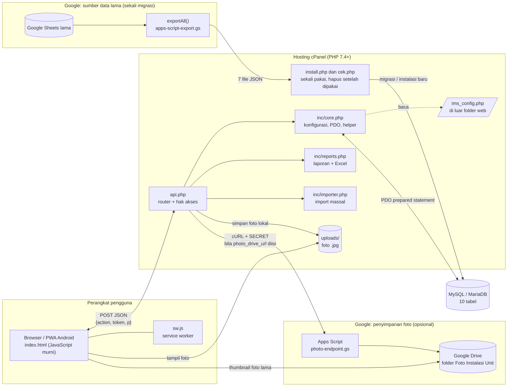

---

## 2. Login dan sesi

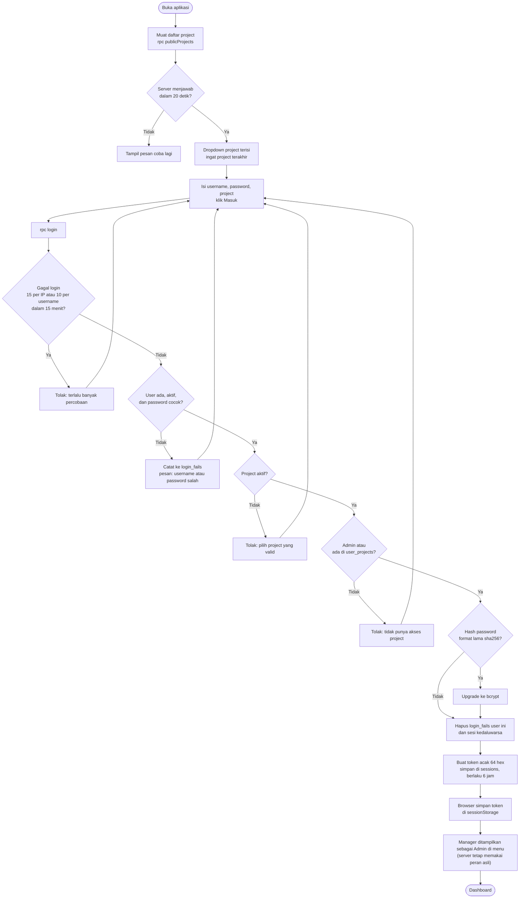

---

## 3. Pipeline setiap permintaan API

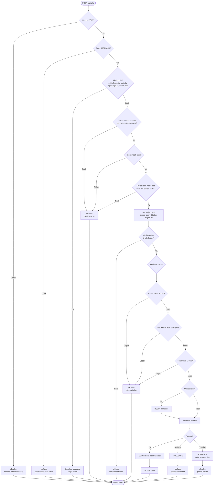

---

## 4. Hak akses per peran

Setiap peran memiliki semua kemampuan peran di sebelah kirinya, ditambah kemampuannya sendiri.

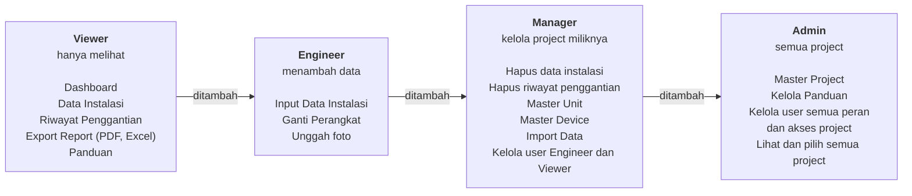

---

## 5. Input data instalasi

```mermaid
flowchart TD
  A(["Menu Input Data Instalasi"]) --> B["rpc formData<br/>unit aktif, device aktif,<br/>unit yang sudah punya data"]
  B --> C["Pilih nomor unit"]
  C --> D{"Unit sudah punya<br/>data instalasi?"}
  D -- "Ya" --> D1["rpc getInstall<br/>isi form dengan data lama"]
  D -- "Tidak" --> D2["Form kosong<br/>semua device Pending"]
  D1 --> E
  D2 --> E["Isi tanggal, status tiap device<br/>(Installed atau Pending), remarks"]
  E --> F["Device butuh SN: isi serial number<br/>Device butuh foto: ambil atau pilih foto"]
  F --> G["Foto diunggah satu per satu<br/>(lihat diagram 7)"]
  G --> H{"Edit data lama dan<br/>SN device Installed berubah?"}
  H -- "Ya" --> H1["Dialog: koreksi salah ketik<br/>atau penggantian perangkat?"]
  H1 -- "Penggantian" --> H2["Pilih alasan:<br/>Rusak, Hilang, Upgrade, Lainnya<br/>+ tanggal dan catatan"]
  H1 -- "Koreksi" --> I
  H1 -- "Batal" --> E
  H2 --> I
  H -- "Tidak" --> I["rpc saveInstall<br/>{unitId, date, details, remarks, changes}"]

  I --> S1{"Unit milik project ini?"}
  S1 -- "Tidak" --> ERR(["Error ditolak server"])
  S1 -- "Ya" --> S2{"Tanggal format yyyy-mm-dd?"}
  S2 -- "Tidak" --> ERR
  S2 -- "Ya" --> S3{"Setiap device ada<br/>di project ini?"}
  S3 -- "Tidak" --> ERR
  S3 -- "Ya" --> S4{"Status Installed<br/>atau Pending?"}
  S4 -- "Tidak" --> ERR
  S4 -- "Ya" --> S5{"Installed dan butuh SN<br/>tetapi SN kosong?"}
  S5 -- "Ya" --> ERR
  S5 -- "Tidak" --> S6{"Foto wajib aktif dan<br/>foto kosong?"}
  S6 -- "Ya" --> ERR
  S6 -- "Tidak" --> S7{"Ada minimal 1 device?"}
  S7 -- "Tidak" --> ERR
  S7 -- "Ya" --> T["Hitung penggantian dari changes:<br/>device lama Installed dan punya SN,<br/>SN baru berbeda,<br/>alasan termasuk daftar"]
  T --> U{"Alasan tidak valid?"}
  U -- "Ya" --> ERR
  U -- "Tidak" --> V{"Data instalasi unit<br/>sudah ada?"}
  V -- "Ya" --> V1["UPDATE installations<br/>tanggal, remarks, details, updated_at"]
  V -- "Tidak" --> V2["INSERT installations<br/>1 unit = 1 baris"]
  V1 --> W
  V2 --> W["INSERT replacements<br/>untuk setiap penggantian"]
  W --> X["COMMIT"]
  X --> Y(["Notifikasi tersimpan<br/>kembali ke daftar"])
```

---

## 6. Ganti perangkat

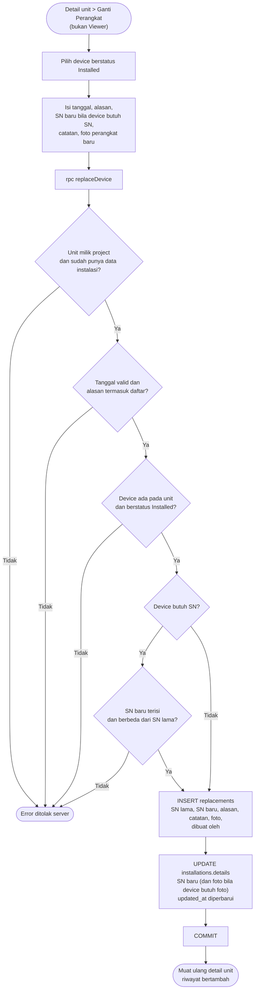

---

## 7. Unggah foto

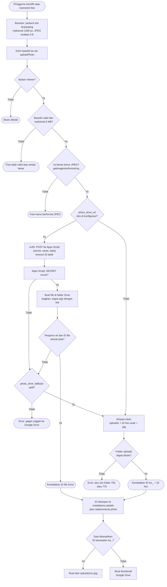

---

## 8. Laporan PDF dan Excel

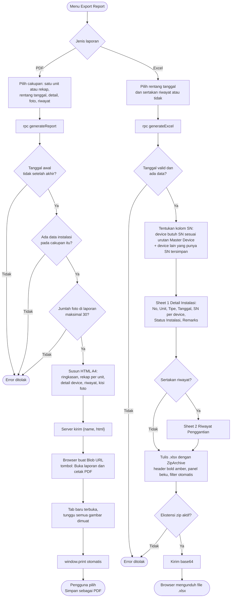

---

## 9. Import data (periksa, simpan, batalkan)

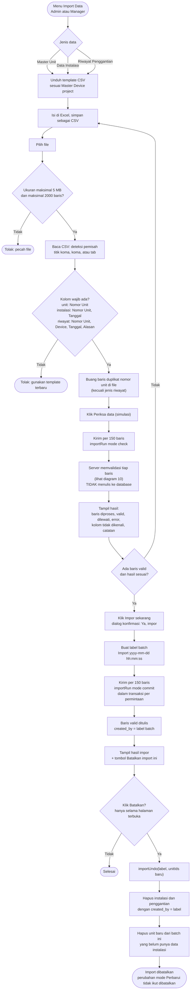

---

## 10. Validasi per baris import

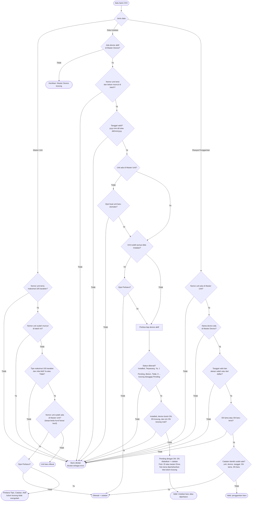

---

## 11. Aturan kelola user

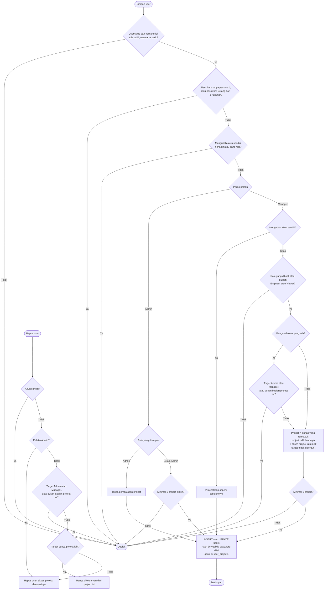

---

## 12. Instalasi baru dan migrasi dari Google Sheets

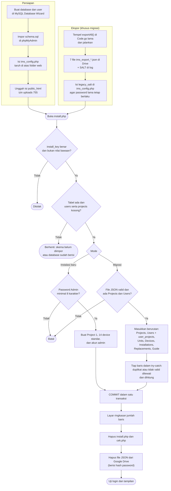

---

## 13. PWA dan service worker

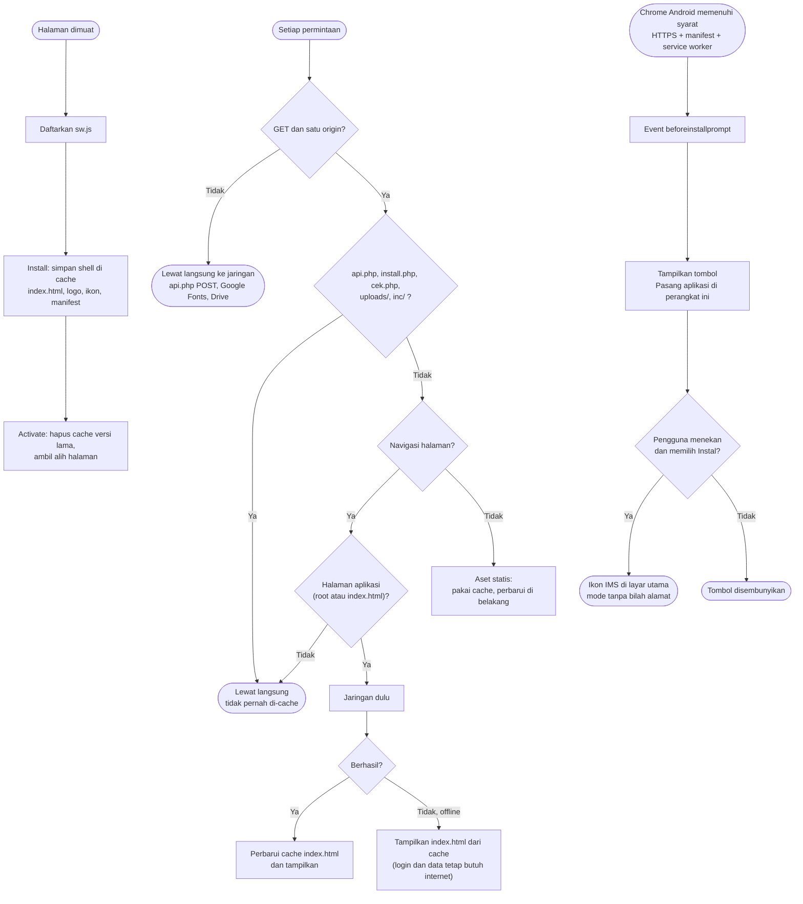

---

## 14. Relasi database (ERD)

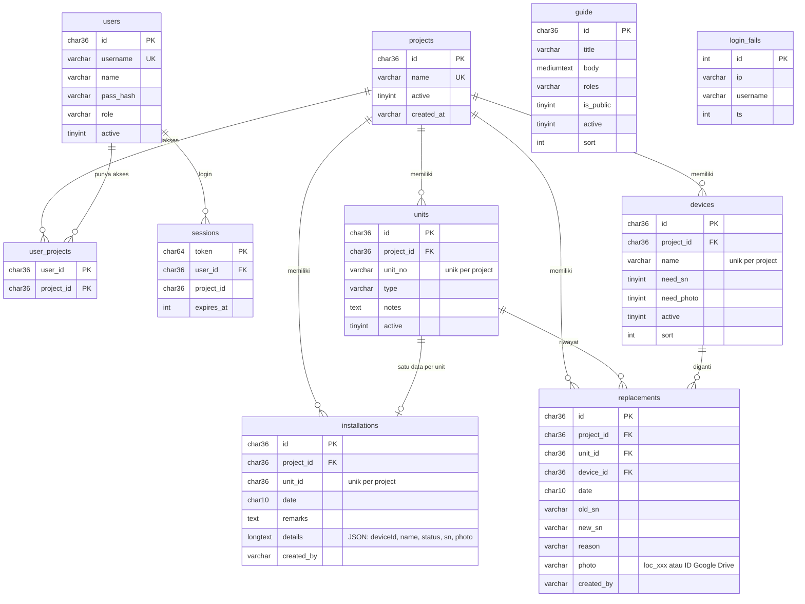
