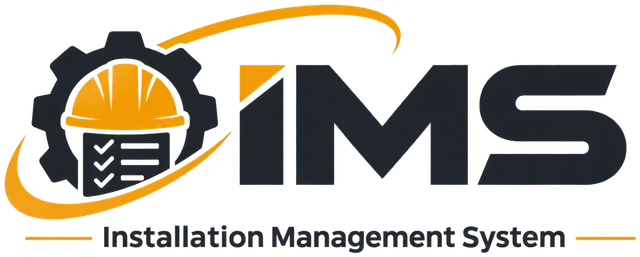

Aplikasi web untuk mendokumentasikan instalasi perangkat pada kendaraan tambang, multi-project, dengan serial number, foto, riwayat penggantian, dan laporan.
Berjalan di hosting cPanel biasa (PHP + MySQL), tanpa framework dan tanpa proses build.

---

## Daftar isi

- [Fitur](#fitur)
- [Arsitektur dan teknologi](#arsitektur-dan-teknologi)
- [Struktur folder](#struktur-folder)
- [Prasyarat](#prasyarat)
- [Instalasi](#instalasi)
- [Migrasi dari versi Google Apps Script](#migrasi-dari-versi-google-apps-script)
- [Opsional: simpan foto ke Google Drive](#opsional-simpan-foto-ke-google-drive)
- [Pasang sebagai aplikasi Android (PWA)](#pasang-sebagai-aplikasi-android-pwa)
- [Peran dan hak akses](#peran-dan-hak-akses)
- [Referensi API](#referensi-api)
- [Skema database](#skema-database)
- [Keamanan](#keamanan)
- [Pemecahan masalah](#pemecahan-masalah)
- [Pembaruan aplikasi](#pembaruan-aplikasi)
- [Kontribusi dan lisensi](#kontribusi-dan-lisensi)

## Fitur

| Area | Keterangan |
|---|---|
| **Multi-project** | Setiap project punya Master Unit, Master Device, data instalasi, dan riwayat sendiri. User hanya melihat project yang diberikan Admin. |
| **Dashboard** | Progres keseluruhan, unit lengkap/pending/belum diinstal, progres per device, dan device yang paling sering diganti. |
| **Input instalasi** | Per unit: tanggal, status tiap device (*Installed* / *Pending*), serial number, foto, dan remarks. Satu unit = satu data (upsert). |
| **Penggantian perangkat** | Dicatat saat SN diubah (dengan alasan, tanggal, catatan, foto) atau lewat tombol *Ganti Perangkat*. |
| **Laporan** | PDF (rekap semua unit atau satu unit, dengan foto dan riwayat) dan Excel (`.xlsx` dengan dua sheet). |
| **Import data** | Impor massal data instalasi dan riwayat penggantian (khusus Admin), dengan mode *periksa* sebelum *simpan* dan fitur batalkan. |
| **Panduan (wiki)** | Artikel bantuan yang dikelola Admin, dengan pengaturan peran pembaca dan tampil di halaman login. |
| **Manajemen user** | Empat peran (Admin, Manager, Engineer, Viewer) dengan akses per project. |
| **PWA** | Dapat dipasang di layar utama Android. |
| **Foto** | Disimpan di hosting (`uploads/`) atau, opsional, di Google Drive. |

## Arsitektur dan teknologi

```
Browser (index.html, JavaScript murni)
        │  POST JSON  { action, token, p }
        ▼
   api.php  ── router + hak akses ──►  MySQL / MariaDB (PDO)
        │
        ├── inc/reports.php   laporan (HTML siap cetak) dan Excel (.xlsx via ZipArchive)
        ├── inc/importer.php  import massal
        └── (opsional) cURL ──► Apps Script kecil ──► Google Drive   (penyimpanan foto)
```

- **Frontend:** satu berkas `index.html` (HTML + CSS + JavaScript murni). Tidak ada framework dan tidak perlu build.
- **Backend:** PHP 7.4 atau lebih baru (diuji target hingga PHP 8.5), satu pintu `api.php`.
- **Database:** MySQL / MariaDB, InnoDB, `utf8mb4`.
- **Sesi:** token acak 256-bit yang disimpan di tabel `sessions` (berlaku 6 jam, dapat diatur).
- **Password:** bcrypt (`password_hash`). Hash lama SHA-256 dari versi Apps Script otomatis di-upgrade saat login pertama.

## Struktur folder

```
ims-cpanel/
├── README.md
├── schema.sql                  # skema database (jalankan di phpMyAdmin)
├── ims_config.sample.php       # contoh konfigurasi (disalin jadi ims_config.php, di luar folder web)
├── apps-script-export.gs       # ekspor data dari Google Sheets (untuk migrasi)
├── photo-endpoint.gs           # opsional: endpoint simpan foto ke Google Drive
└── public_html/
    ├── index.html              # seluruh antarmuka
    ├── api.php                 # API
    ├── install.php             # alat instalasi/migrasi sekali pakai (HAPUS setelah dipakai)
    ├── cek.php                 # halaman diagnosa sementara (HAPUS setelah dipakai)
    ├── sw.js                   # service worker (PWA)
    ├── site.webmanifest        # manifest PWA
    ├── logo.png, favicon.ico, favicon-32.png,
    │   apple-touch-icon.png, icon-192.png,
    │   icon-512.png, icon-maskable-512.png
    ├── .htaccess
    ├── inc/                    # kode internal (diblokir dari akses web)
    │   ├── core.php            # konfigurasi, koneksi database, helper
    │   ├── reports.php         # laporan PDF dan Excel
    │   ├── importer.php        # import data
    │   └── .htaccess
    └── uploads/                # foto yang diunggah (hanya .jpg yang bisa diakses)
        └── .htaccess
```

## Prasyarat

- Hosting cPanel (atau server Apache lain) dengan **PHP 7.4+** dan **MySQL/MariaDB**.
- Ekstensi PHP: `pdo_mysql`, `mbstring`, `zip`, `ctype`, `json`, dan `curl` (hanya jika memakai penyimpanan foto Google Drive).
- **HTTPS** aktif (wajib agar dapat dipasang sebagai PWA).
- Folder `uploads/` dapat ditulis (izin `755` atau `775`).

## Instalasi

### 1. Database

1. Di cPanel buka **MySQL® Database Wizard**, buat database dan user, lalu beri **ALL PRIVILEGES**. Catat nama lengkapnya (cPanel menambahkan awalan akun).
2. Di **phpMyAdmin**, pilih database, tab **Import**, lalu impor `schema.sql`.

### 2. Konfigurasi

1. Salin `ims_config.sample.php` menjadi `ims_config.php`.
2. Isi `host`, `db`, `user`, `pass`, `install_key` (teks acak panjang), dan `timezone`.
3. Unggah ke folder **di atas** document root (misalnya `/home/NAMAUSER/ims_config.php`), **bukan** ke dalam `public_html` atau folder situs.

Aplikasi mencari `ims_config.php` pada empat tingkat folder induk dari document root.

| Kunci | Fungsi |
|---|---|
| `host`, `db`, `user`, `pass` | Koneksi database |
| `install_key` | Kunci untuk membuka `install.php` |
| `legacy_salt` | SALT dari Apps Script, agar password lama tetap berlaku (opsional) |
| `session_seconds` | Lama sesi login, default 6 jam |
| `base_url` | Alamat dasar situs untuk tautan foto di laporan (opsional, otomatis bila kosong) |
| `timezone` | Zona waktu, mis. `Asia/Makassar` atau `Asia/Jayapura` |
| `photo_drive_url`, `photo_drive_secret`, `photo_drive_fallback` | Penyimpanan foto Google Drive (opsional) |

### 3. Unggah aplikasi

Unggah seluruh isi `public_html/` ke document root situs (termasuk `.htaccess`; aktifkan *Show Hidden Files* di File Manager). Atur izin folder `uploads/` ke `755`.

### 4. Inisialisasi data

Buka `https://domain-anda/install.php`, masukkan `install_key`, lalu pilih salah satu:

- **Instalasi baru**: membuat satu project, 14 device standar, dan akun `admin` dengan password yang Anda isi (minimal 8 karakter).
- **Migrasi**: unggah data dari versi Apps Script (lihat bagian berikut).

### 5. Bersihkan dan amankan

1. **Hapus `install.php` dan `cek.php`** dari server.
2. Aktifkan SSL (cPanel > **SSL/TLS Status** > *Run AutoSSL*), lalu aktifkan pengalihan HTTPS di `.htaccess` (blok yang diberi komentar).
3. Aktifkan backup untuk database dan folder `uploads/`.

> `cek.php` menampilkan versi PHP, ekstensi, jalur konfigurasi, dan status koneksi database tanpa menampilkan password. Berguna untuk diagnosa saat pemasangan pertama, tetapi jangan dibiarkan di server.

## Migrasi dari versi Google Apps Script

1. Buka Google Sheet lama, **Ekstensi > Apps Script**, tempel isi `apps-script-export.gs` di bawah `Code.gs`, lalu jalankan `exportAll()` sekali.
2. Hasilnya 7 file `ims_export_<Sheet>.json` di Google Drive, ditambah nilai **SALT** di log eksekusi. Isi SALT ke `legacy_salt`.
3. Unduh ketujuh file, lalu buka `install.php`, pilih **Migrasi**, dan unggah semuanya sekaligus.
4. Setelah selesai, **hapus file JSON dari Google Drive** (berisi hash password) dan hapus fungsi `exportAll()`.

Catatan migrasi:

- ID (UUID) dipertahankan, sehingga relasi data dan detail instalasi tetap utuh.
- Foto lama tetap tampil dari tautan Google Drive. Foto baru memakai penyimpanan yang Anda pilih.
- Akses user ke project dipindahkan dari kolom `projectIds` (teks) ke tabel `user_projects`.
- Baris duplikat atau tidak valid dilewati, dan jumlahnya ditampilkan di layar hasil.

## Opsional: simpan foto ke Google Drive

Secara bawaan foto disimpan di `uploads/` pada hosting. Untuk menyimpannya di Google Drive, gunakan endpoint Apps Script kecil yang dipanggil dari sisi server PHP, jadi pengguna tidak pernah membuka `script.google.com`.

1. Di [script.google.com](https://script.google.com), buat proyek baru dan tempel `photo-endpoint.gs`.
2. Jalankan fungsi `setup`, lalu salin **SECRET** dari log.
3. **Deploy > Deployment baru > Aplikasi web**, dengan *Jalankan sebagai: Saya* dan *Yang memiliki akses: Siapa saja*. Salin URL `/exec`.
4. Isi di `ims_config.php`:

```php
'photo_drive_url'      => 'https://script.google.com/macros/s/XXXX/exec',
'photo_drive_secret'   => 'SECRET_DARI_LOG',
'photo_drive_fallback' => true,   // true = bila Drive gagal, foto disimpan lokal agar tidak hilang
```

Setiap permintaan ke endpoint wajib membawa `SECRET`. Perubahan kode endpoint harus dideploy sebagai **Versi baru** pada deployment yang sama agar URL tidak berubah.

## Pasang sebagai aplikasi Android (PWA)

Syaratnya HTTPS aktif. Di **Chrome Android**, buka situs lalu ketuk tombol **Pasang aplikasi di perangkat ini** di halaman login, atau menu **⋮ > Instal aplikasi**. Di iPhone/iPad gunakan Safari > **Bagikan > Tambahkan ke Layar Utama**.

- Service worker (`sw.js`) hanya menyimpan cache halaman awal dan aset statis. Data (`api.php`) dan foto (`uploads/`) tidak pernah disimpan di cache.
- Aplikasi tetap butuh internet untuk login dan data. Input offline tidak didukung.
- Setiap kali `index.html` atau logo diganti, naikkan `VERSION` di `sw.js` agar perangkat memuat versi terbaru.

## Peran dan hak akses

| Kemampuan | Admin | Manager | Engineer | Viewer |
|---|:---:|:---:|:---:|:---:|
| Dashboard, Data Instalasi, Riwayat, Export laporan | ✅ | ✅ | ✅ | ✅ |
| Input instalasi dan ganti perangkat | ✅ | ✅ | ✅ | ❌ |
| Hapus data instalasi | ✅ | ✅ | ❌ | ❌ |
| Master Unit dan Master Device | ✅ | ✅ | ❌ | ❌ |
| Kelola user (Engineer dan Viewer) | ✅ | ✅ | ❌ | ❌ |
| Kelola user Admin/Manager | ✅ | ❌ | ❌ | ❌ |
| Master Project | ✅ | ❌ | ❌ | ❌ |
| Kelola Panduan | ✅ | ❌ | ❌ | ❌ |
| Import data | ✅ | ❌ | ❌ | ❌ |

- Admin melihat semua project. Peran lain hanya project yang ditetapkan.
- Manager hanya mengelola user pada project miliknya, dan hanya peran Engineer dan Viewer.
- Hak akses ditegakkan di server (`api.php`), bukan hanya di tampilan.

## Referensi API

Satu endpoint: `POST /api.php` dengan body JSON dan respons selalu JSON.

```json
{ "action": "listInstalls", "token": "<token login>", "p": { } }
```

```json
{ "ok": true, "data": [ ] }
{ "ok": false, "error": "Pesan kesalahan" }
```

| Kelompok | Aksi |
|---|---|
| Publik (tanpa token) | `publicProjects`, `publicGuide`, `loginBg`, `login`, `logout` |
| Umum (login) | `me`, `dashboard`, `formData`, `listInstalls`, `getInstall`, `listReplacements`, `listGuide`, `generateReport`, `generateExcel` |
| Tulis (bukan Viewer) | `saveInstall`, `replaceDevice`, `uploadPhoto` |
| Manager ke atas | `deleteInstall`, `listUnits`, `saveUnit`, `deleteUnit`, `listDevices`, `saveDevice`, `deleteDevice`, `listUsers`, `saveUser`, `deleteUser`, `assignableProjects` |
| Admin | `listProjects`, `saveProject`, `deleteProject`, `saveGuide`, `deleteGuide`, `importRun`, `importUndo` |

Operasi tulis berjalan di dalam transaksi database. Respons `generateReport` berisi HTML siap cetak, dan `generateExcel` berisi berkas `.xlsx` dalam base64.

## Skema database

| Tabel | Isi |
|---|---|
| `projects` | Daftar project |
| `users`, `user_projects` | Akun dan akses per project |
| `units` | Master unit (unik per project) |
| `devices` | Master device (unik per project), dengan penanda perlu SN dan perlu foto |
| `installations` | Satu baris per unit. Kolom `details` berisi JSON status, SN, dan foto tiap device |
| `replacements` | Riwayat penggantian perangkat |
| `guide` | Artikel panduan |
| `sessions` | Sesi login |
| `login_fails` | Pencatatan login gagal untuk pembatasan percobaan |

ID memakai UUID (`CHAR(36)`). Foto yang disimpan lokal diberi ID berawalan `loc_`, selain itu dianggap ID file Google Drive.

## Keamanan

- Password di-hash dengan bcrypt. Hash lama SHA-256 di-upgrade otomatis saat login pertama.
- Login dibatasi setelah terlalu banyak percobaan gagal (15 per IP atau 10 per username dalam 15 menit).
- Token sesi dikirim lewat body permintaan, bukan cookie, sehingga tidak rentan CSRF.
- Semua query memakai *prepared statement*. Keluaran HTML disaring (`htmlspecialchars`) dan di frontend memakai fungsi `esc()`.
- Konfigurasi (`ims_config.php`) berada di luar folder web. Folder `inc/` dan berkas sensitif diblokir lewat `.htaccess`.
- Folder `uploads/` hanya melayani berkas `.jpg` dan tidak mengeksekusi skrip. Unggahan divalidasi sebagai JPEG sungguhan dan dibatasi ukurannya.
- URL foto tidak dapat ditebak (32 karakter heksadesimal acak), tetapi siapa pun yang memiliki tautan dapat membukanya, sama seperti foto di Google Drive dengan pembagian "siapa saja dengan link".
- Hapus `install.php` dan `cek.php` setelah pemasangan.

## Pemecahan masalah

| Gejala | Penyebab dan solusi |
|---|---|
| Halaman putih atau HTTP 500 | Lihat `error_log` di cPanel. Buka `cek.php` untuk diagnosa cepat |
| `ims_config.php TIDAK DITEMUKAN` | Taruh di salah satu folder yang tercantum di keluaran `cek.php` (umumnya `/home/NAMAUSER/`) |
| Dropdown project kosong | Database belum diinisialisasi lewat `install.php`, atau tabel `projects` kosong |
| Login lama gagal setelah migrasi | `legacy_salt` belum diisi atau salah. Atau reset password lewat menu User Management |
| `Terlalu banyak percobaan login` | Tunggu 15 menit, atau kosongkan tabel `login_fails` |
| Foto gagal diunggah | Izin folder `uploads/` ke `775`, dan periksa `post_max_size` minimal 8M |
| Foto tidak muncul di laporan | Isi `base_url` di konfigurasi dengan alamat `https://` situs |
| Excel gagal dibuat | Aktifkan ekstensi PHP `zip` |
| Foto tidak masuk Google Drive | Cek ekstensi `curl`, URL dan `SECRET` di konfigurasi, lalu lihat `error_log` (awalan `[IMS] upload Drive`) |
| Tombol *Pasang aplikasi* tidak muncul | Pastikan HTTPS, `sw.js` dan `site.webmanifest` terunggah, lalu muat ulang |

## Pembaruan aplikasi

1. Cadangkan database dan folder `uploads/`.
2. Unggah berkas baru dan timpa yang lama (jangan menimpa `ims_config.php`, `.htaccess` yang sudah Anda ubah, dan isi `uploads/`).
3. Naikkan `VERSION` di `sw.js` bila `index.html` atau aset berubah.
4. Jika ada perubahan skema, jalankan perintah SQL yang disertakan pada catatan rilis.

## Kontribusi dan lisensi

Saran dan perbaikan dipersilakan lewat *issue* atau *pull request*.

Dikembangkan oleh **Rusyanto**.
